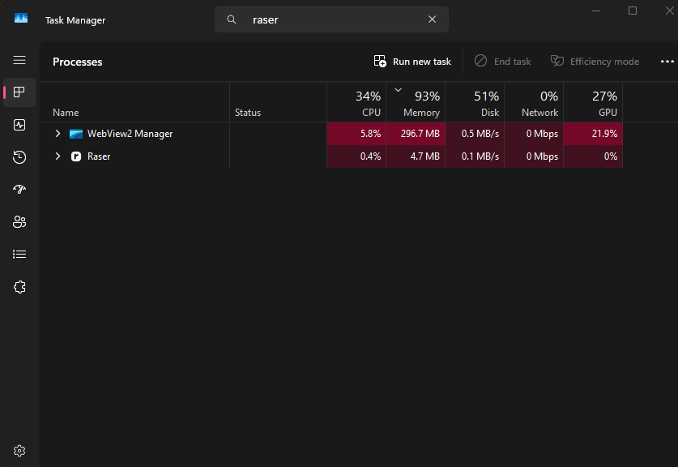
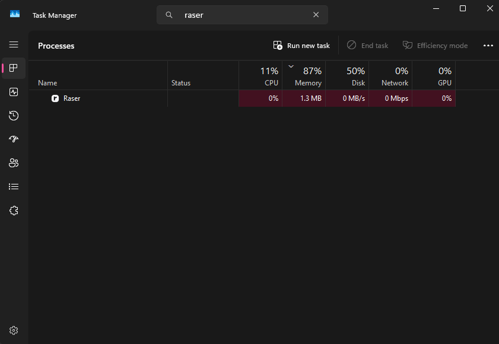

# Raser

Native Windows desktop music player built with Tauri v2 and Rust. Streams from YouTube Music and SoundCloud with a Material You 3 interface, synchronized lyrics, Discord Rich Presence, and native Windows media integration.

## Overview

Raser offloads audio decoding, streaming, and frequency analysis to a native Rust backend (`rodio`, `symphonia`, `rustfft`) instead of running Web Audio inside Chromium. When closed to the system tray (v2.0.0+), WebView2 is completely unloaded (`0` `msedgewebview2.exe` processes) while music playback, queue auto-advance, media keys, and Discord Rich Presence continue running in Rust.

| Metric | Raser | Typical Electron Player |
| :--- | :--- | :--- |
| Tray Playback RAM (zero WebView2) | **1.3 MB** | 450–750 MB |
| Open Window RAM | **~301 MB** (`296.7 MB` WebView2 + `4.7 MB` Raser) | 600–950 MB |
| Installer Size | ~8 MB | 120–180 MB |
| Cold Start | < 0.6 s | 3.5–6.0 s |
| Audio Engine | Rust (`rodio` + WASAPI) | Web Audio API |

| Open Window | Tray Sleep (Zero WebView2) |
| :---: | :---: |
|  |  |

## Features

### Audio Engine
- Native decoding and playback in Rust via `rodio` and `symphonia`, bypassing Chromium's audio process.
- Lock-free FFT visualizer using `rustfft` and an `rtrb` ring buffer on a dedicated audio thread.
- Progressive in-memory and local SSD stream caching for fast seeking.
- Viewport prewarming for visible playlist tracks and dual-tier chunked streaming.
- Background playback with suspended UI loops and working-set trimming when minimized to tray.

### Interface and Lyrics
- Dynamic accent palette extracted from the current track's album art.
- Shared frame-paced render loop with pre-blurred offscreen ambient backgrounds (0% render CPU/GPU when paused).
- Synchronized word-by-word and line-by-line lyrics, plus a fullscreen karaoke view.
- Spotify playlist import with duration matching (`±5s` / `±15s`) and remix/live filtering.

### Windows Integration
- Taskbar thumbnail toolbar (`ITaskbarList3`) for Previous, Play/Pause, and Next controls.
- System tray minimization with global media hotkeys.
- Windows Media Controls (SMTC) support for hardware media keys.
- Discord Rich Presence showing current track, artist, elapsed time, and album art.

## Download and Installation

Download the latest Windows installer from the [Releases](https://github.com/tetoverse/Raser/releases/latest) page:

- **NSIS Installer:** `Raser_<version>_x64-setup.exe`
- **MSI Package:** `Raser_<version>_x64_en-US.msi`

Silent install:

```cmd
Raser_<version>_x64-setup.exe /S
```

## Keyboard Shortcuts

| Shortcut | Action |
| :--- | :--- |
| `Space` | Play / Pause |
| `MediaTrackNext` / `Ctrl + Right` | Next Track |
| `MediaTrackPrevious` / `Ctrl + Left` | Previous Track |
| `MediaStop` | Stop Playback |
| `Up` / `Down` | Volume Up / Down (5%) |
| `Ctrl + F` | Focus Search |
| `Esc` | Close Modals / Clear Selection |

## Building from Source

### Prerequisites
- [Rust](https://rustup.rs/) 1.90+
- Node.js 18+
- Visual Studio C++ Build Tools with Windows 10/11 SDK

### Build

```bash
git clone https://github.com/tetoverse/Raser.git
cd Raser

cd src-tauri
cargo check

cd ..
npx @tauri-apps/cli build
```

Generated installers are placed in:
- `src-tauri/target/release/bundle/nsis/Raser_<version>_x64-setup.exe`
- `src-tauri/target/release/bundle/msi/Raser_<version>_x64_en-US.msi`

## Project Structure

```text
Raser/
├── src-tauri/
│   ├── src/
│   │   ├── main.rs            # Application entry point
│   │   ├── lib.rs             # Tauri commands and background monitors
│   │   ├── audio_core.rs      # Rust audio engine (rodio, symphonia, FFT)
│   │   ├── bg_queue.rs        # Headless Rust background queue & stream resolver
│   │   ├── discord.rs         # Discord Rich Presence IPC
│   │   ├── taskbar.rs         # Windows taskbar thumbnail controls
│   │   ├── storage.rs         # Local JSON storage
│   │   └── updater.rs         # Auto-updater
│   ├── Cargo.toml             # Rust dependencies and release profile
│   └── tauri.conf.json        # Tauri and WebView2 configuration
└── ui/
    ├── index.html
    ├── styles.css
    ├── app.js
    └── tauri-bridge.js        # IPC bindings to Rust backend
```

## License

MIT — see [LICENSE](LICENSE) for details.
